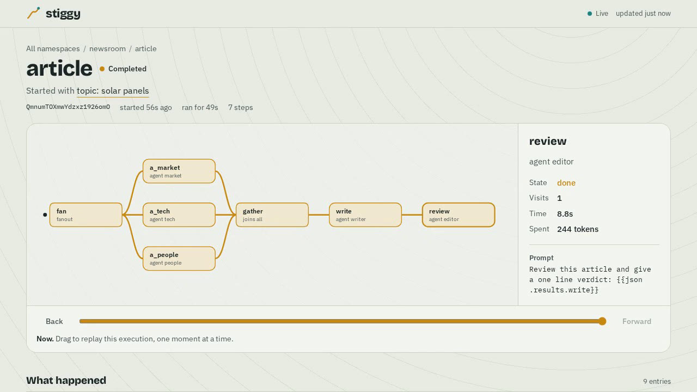
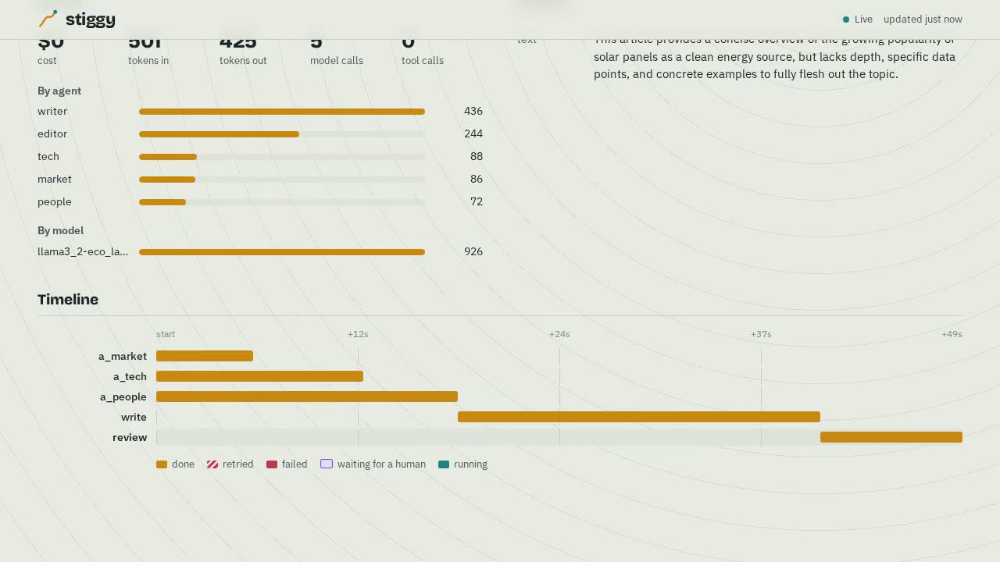

Say you want a team of AI agents. A researcher finds the facts, a writer turns them into an article. It works on your laptop, and then the program crashes halfway and the work is gone.

Stiggy is my answer to that. It is a way to run teams of agents that survive crashes, take the shape you design, and show every step in a dashboard. I made a five minute video that walks through all of it, and the rest of this post follows the same path.



## What Stiggy is

Stiggy connects two libraries I wrote. [Phero](https://github.com/henomis/phero) provides the agents: a model, a role, tools, memory. [Packtrail](https://github.com/henomis/packtrail) provides the durable workflows. Stiggy is the glue, and it adds crews, patterns, human review and a dashboard on top.

It has no engine of its own. Your team is compiled into ordinary Packtrail flows, and a step that runs an agent is a normal step of the flow. That is where the durability comes from.

## One fleet file

You describe the whole team once, in a fleet file: the models, the agents and the crews that put them to work.

```yaml
namespace: newsroom
models:
  fast: {provider: ollama, model: llama3.2}
agents:
  researcher: {model: fast, role: Researcher}
  writer: {model: fast, role: Writer}
crews:
  article:
    tasks:
      - {id: research, agent: researcher}
      - {id: write, agent: writer}
```

Then the `stiggy` command takes over:

```bash
stiggy validate fleet.yaml        # every problem, with its line
stiggy run fleet.yaml &           # serve the fleet
stiggy start -ns newsroom article -input '{"topic": "solar"}' -wait
```

`validate` checks the file before anything runs, `run` serves the fleet, and `start` launches a job and waits for the result.

## Built to survive crashes

Every step is saved in an event log. If a worker crashes, the finished steps stay saved, and only the open step runs again. When there is more work than one process can take, you start more workers: every process uses the same fleet file and picks its part.

Because the history is stored, an execution can also be inspected, forked and rerun after the fact. That is how the dashboard can show a run as it was.

## Choose the shape of your team

A team does not have to be a straight line. A flow is a graph, and you choose its shape. These are the building blocks.

**Fan out and fan in.** A fan out node starts several agents at the same time, so the work takes as long as the slowest agent, not the sum of all of them. A join node is the fan in: it collects the answers and decides when the flow goes on. Its policy says how:

- `all` waits for every branch.
- `any` continues on the first answer and cancels the others.
- `quorum:N` continues once N branches have answered.
- `min:N` waits for everyone, then continues if at least N succeeded, so one failed researcher does not stop the team.

```yaml
flows:
  article:
    nodes:
      - {id: fan, type: fanout, branches: [a, b, c], next: gather}
      - {id: a, type: task, agent: market}
      - {id: b, type: task, agent: tech}
      - {id: c, type: task, agent: people}
      - {id: gather, type: join, policy: "min:2", next: write}
      - {id: write, type: task, agent: writer}
```

**Map.** A map node runs the same step once for every item in a list, side by side. A list of documents becomes a list of summaries, and a later step reduces them into one answer.

**Choices and loops.** A choice node picks the next step with a rule, or the agent itself chooses from the routes you allow. Every choice is stored in the history, so you can see why the flow went that way. Routes can also go backwards: a writer and an editor can repeat until the editor accepts the text, and a round limit and a budget stop the loop from running forever.

**Waiting and nesting.** An await node pauses the flow until a signal arrives from outside. A human review pauses until a person approves or sends feedback, and the wait costs nothing because no process sits blocked. A subflow runs another flow as one step, so a big design stays readable.

## Ready-made patterns

You do not have to draw every graph yourself. These patterns expand into flows, and `stiggy compile` shows you the graph:

- **Crew:** tasks in order.
- **Supervisor:** a boss routes work to one worker at a time.
- **Swarm:** agents hand off to each other.
- **Debate:** agents argue in parallel and a judge decides.
- **Plan and execute:** a planner lists the steps and an executor runs them in parallel.
- **Evaluator loop:** a generator and an evaluator repeat until the output passes.

```yaml
patterns:
  team: {type: supervisor, supervisor: boss, workers: [researcher, writer]}
  polish: {type: evaluator_optimizer, generator: writer, evaluator: editor, max_rounds: 3}
  argue: {type: debate, debaters: [optimist, skeptic], judge: editor, rounds: 2}
```

Agents can also live outside your fleet. A step can call a remote agent that someone else serves, you can expose your own agents and flows so other programs can call them, and a schedule starts a flow on a timer.

## The dashboard

`stiggy-dashboard` is one command, and it shows every namespace you run. The front page gives each namespace a band with its running, waiting, completed and failed executions, and what they cost. Steps that wait for a person are listed, and you can answer them from the page.

An execution has its own page. Here is a real run of the fan out flow above, with a small local model playing all the agents: a topic goes in, three researchers start together, the join waits for all of them, and then the writer and the editor finish the article.



The trail on top shows the steps the run walked. Click a step and the side panel shows its state, its time, its tokens and its prompt. Below it, the story lists every answer and every choice. A slider replays the run one moment at a time, and the graph redraws as it was. Spending is counted by agent and by model, and a timeline shows the three researchers working in parallel.



You can also cancel a run, or answer a waiting step, from the same page. Start the dashboard with `-read-only` to turn both off.

## The same fleet in Go

Everything above also works as a library. The same fleet builds from Go options, and a step can be your own Go function instead of an agent:

```go
app, _ := stiggy.New(nc,
    stiggy.WithNamespace("newsroom"),
    stiggy.WithAgent("researcher", spec.Agent{Model: "fast"}),
    stiggy.WithAgent("writer", spec.Agent{Model: "fast"}),
    stiggy.WithCrew("article", articleCrew),
)
go app.Run(ctx)
```

The YAML and the Go options build the same model, so you can start with a file and move to code when you need to.

## Open source, and still young

Stiggy is open source under the Apache 2.0 license. It is at version 0.6.0: the fleet format and the Go API may still move, and I would rather hear now what feels wrong.

To try it you need a NATS server with JetStream running, and Go:

```bash
nats-server -js &
go install github.com/henomis/stiggy/cmd/stiggy@latest
go install github.com/henomis/stiggy/cmd/stiggy-dashboard@latest
```

The code, the examples and the guide are in the [repository](https://github.com/henomis/stiggy). Write a fleet, kill a worker in the middle of a run, and open the dashboard to see where it picked up. Then tell me in an issue what you built, or what got in your way.

A team of agents is easy to build. One that survives a crash, takes the shape you design and shows every step is the part Stiggy is for.
