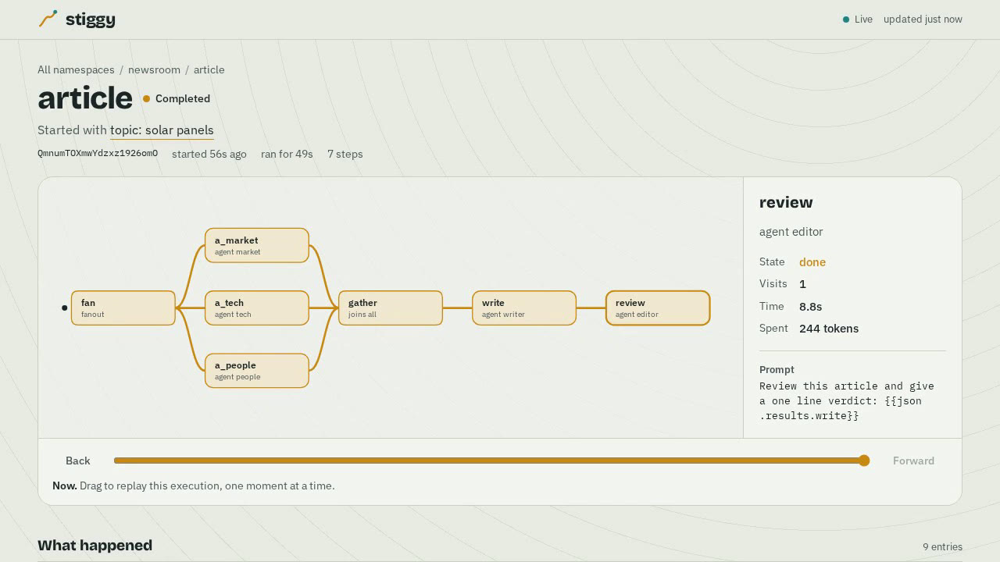
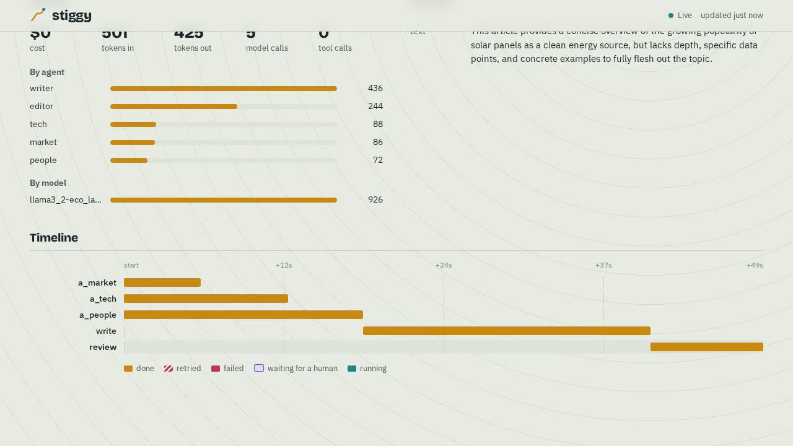

Immagina di volere un team di agenti AI. Un ricercatore trova i fatti, uno scrittore li trasforma in un articolo. Sul tuo portatile funziona, poi il programma va in crash a metà strada e il lavoro è perso.

Stiggy è la mia risposta. È un modo di far girare team di agenti che sopravvivono ai crash, prendono la forma che progetti e mostrano ogni passo in una dashboard. Ho fatto un video di cinque minuti che li attraversa tutti, e il resto di questo articolo segue lo stesso percorso.



## Cos'è Stiggy

Stiggy collega due librerie che ho scritto io. [Phero](https://github.com/henomis/phero) fornisce gli agenti: un modello, un ruolo, tool, memoria. [Packtrail](https://github.com/henomis/packtrail) fornisce i workflow durevoli. Stiggy è la colla, e ci aggiunge sopra crew, pattern, revisione umana e una dashboard.

Non ha un motore suo. Il tuo team viene compilato in normali flow di Packtrail, e un passo che esegue un agente è un normale passo del flow. È da qui che arriva la durabilità.

## Un solo file di fleet

Descrivi tutto il team una volta sola, in un file di fleet: i modelli, gli agenti e le crew che li mettono al lavoro.

```yaml
namespace: newsroom
models:
  fast: {provider: ollama, model: llama3.2}
agents:
  researcher: {model: fast, role: Researcher}
  writer: {model: fast, role: Writer}
crews:
  article:
    tasks:
      - {id: research, agent: researcher}
      - {id: write, agent: writer}
```

Poi entra in gioco il comando `stiggy`:

```bash
stiggy validate fleet.yaml        # ogni problema, con la sua riga
stiggy run fleet.yaml &           # serve la fleet
stiggy start -ns newsroom article -input '{"topic": "solar"}' -wait
```

`validate` controlla il file prima che giri qualunque cosa, `run` serve la fleet e `start` lancia un job e aspetta il risultato.

## Costruito per sopravvivere ai crash

Ogni passo viene salvato in un log di eventi. Se un worker va in crash, i passi finiti restano salvati e si rilancia solo il passo rimasto aperto. Quando il lavoro è più di quanto un processo riesca a prendere, avvii altri worker: ogni processo usa lo stesso file di fleet e sceglie la sua parte.

Poiché la storia viene conservata, un'esecuzione si può anche ispezionare, biforcare e rilanciare a posteriori. È così che la dashboard può mostrare una run com'era.

## Scegli la forma del tuo team

Un team non deve essere una linea retta. Un flow è un grafo, e la forma la scegli tu. Questi sono i blocchi di base.

**Fan out e fan in.** Un nodo fan out avvia più agenti nello stesso momento, così il lavoro dura quanto l'agente più lento e non la somma di tutti. Un nodo join è il fan in: raccoglie le risposte e decide quando il flow prosegue. La sua policy dice come:

- `all` aspetta ogni ramo.
- `any` prosegue alla prima risposta e cancella gli altri.
- `quorum:N` prosegue quando N rami hanno risposto.
- `min:N` aspetta tutti, poi prosegue se almeno N hanno avuto successo, così un ricercatore fallito non ferma il team.

```yaml
flows:
  article:
    nodes:
      - {id: fan, type: fanout, branches: [a, b, c], next: gather}
      - {id: a, type: task, agent: market}
      - {id: b, type: task, agent: tech}
      - {id: c, type: task, agent: people}
      - {id: gather, type: join, policy: "min:2", next: write}
      - {id: write, type: task, agent: writer}
```

**Map.** Un nodo map esegue lo stesso passo una volta per ogni elemento di una lista, in parallelo. Una lista di documenti diventa una lista di riassunti, e un passo successivo li riduce a un'unica risposta.

**Scelte e cicli.** Un nodo choice sceglie il passo successivo con una regola, oppure è l'agente stesso a scegliere tra le rotte che gli permetti. Ogni scelta viene salvata nella storia, così puoi vedere perché il flow è andato in quella direzione. Le rotte possono anche tornare indietro: uno scrittore e un editor possono ripetere finché l'editor non accetta il testo, e un limite di round e un budget impediscono al ciclo di girare per sempre.

**Attesa e annidamento.** Un nodo await mette in pausa il flow finché non arriva un segnale da fuori. Una revisione umana si ferma finché una persona approva o manda un feedback, e l'attesa non costa nulla perché nessun processo resta bloccato. Un subflow esegue un altro flow come un unico passo, così un progetto grande resta leggibile.

## Pattern pronti

Non devi disegnare ogni grafo da solo. Questi pattern si espandono in flow, e `stiggy compile` ti mostra il grafo:

- **Crew:** task in ordine.
- **Supervisor:** un capo smista il lavoro a un worker alla volta.
- **Swarm:** gli agenti si passano il testimone.
- **Debate:** gli agenti discutono in parallelo e un giudice decide.
- **Plan and execute:** un planner elenca i passi e un executor li esegue in parallelo.
- **Evaluator loop:** un generatore e un valutatore ripetono finché l'output non passa.

```yaml
patterns:
  team: {type: supervisor, supervisor: boss, workers: [researcher, writer]}
  polish: {type: evaluator_optimizer, generator: writer, evaluator: editor, max_rounds: 3}
  argue: {type: debate, debaters: [optimist, skeptic], judge: editor, rounds: 2}
```

Gli agenti possono anche vivere fuori dalla tua fleet. Un passo può chiamare un agente remoto servito da qualcun altro, puoi esporre i tuoi agenti e i tuoi flow perché altri programmi li chiamino, e una schedule avvia un flow a intervalli.

## La dashboard

`stiggy-dashboard` è un solo comando e mostra ogni namespace che gestisci. La pagina iniziale dà a ogni namespace una fascia con le esecuzioni in corso, in attesa, completate e fallite, e quanto costano. I passi che aspettano una persona sono elencati, e puoi rispondere dalla pagina.

Ogni esecuzione ha la sua pagina. Ecco una run vera del flow con fan out qui sopra, con un piccolo modello locale che fa tutti gli agenti: entra un argomento, tre ricercatori partono insieme, il join li aspetta tutti, poi lo scrittore e l'editor finiscono l'articolo.



Il percorso in alto mostra i passi che la run ha fatto. Clicca un passo e il pannello laterale mostra il suo stato, il tempo, i token e il prompt. Sotto, la storia elenca ogni risposta e ogni scelta. Uno slider riproduce la run un momento alla volta, e il grafo si ridisegna com'era. La spesa è contata per agente e per modello, e una timeline mostra i tre ricercatori al lavoro in parallelo.



Dalla stessa pagina puoi anche annullare una run o rispondere a un passo in attesa. Avvia la dashboard con `-read-only` per disattivare entrambe le cose.

## La stessa fleet in Go

Tutto questo funziona anche come libreria. La stessa fleet si costruisce con le opzioni Go, e un passo può essere una tua funzione Go al posto di un agente:

```go
app, _ := stiggy.New(nc,
    stiggy.WithNamespace("newsroom"),
    stiggy.WithAgent("researcher", spec.Agent{Model: "fast"}),
    stiggy.WithAgent("writer", spec.Agent{Model: "fast"}),
    stiggy.WithCrew("article", articleCrew),
)
go app.Run(ctx)
```

Lo YAML e le opzioni Go costruiscono lo stesso modello, quindi puoi partire da un file e passare al codice quando serve.

## Open source, e ancora giovane

Stiggy è open source con licenza Apache 2.0. È alla versione 0.6.0: il formato della fleet e l'API Go possono ancora cambiare, e preferisco sentire adesso che cosa non ti convince.

Per provarlo servono un server NATS con JetStream in esecuzione e Go:

```bash
nats-server -js &
go install github.com/henomis/stiggy/cmd/stiggy@latest
go install github.com/henomis/stiggy/cmd/stiggy-dashboard@latest
```

Il codice, gli esempi e la guida sono nel [repository](https://github.com/henomis/stiggy). Scrivi una fleet, uccidi un worker a metà di una run e apri la dashboard per vedere da dove è ripartita. Poi raccontami in una issue che cosa hai costruito, o che cosa ti ha dato fastidio.

Un team di agenti è facile da costruire. Uno che sopravvive a un crash, prende la forma che progetti e mostra ogni passo è la parte per cui esiste Stiggy.
